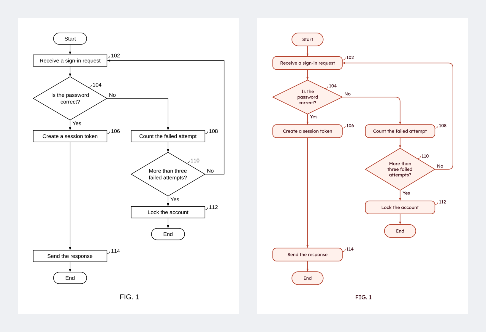

# Patent Flowchart Maker (Coral): steps in, filing-ready flowchart out

Coral turns a description, a claim, or a full claim set into a decision flowchart. Describe what the thing does, paste claims, type the steps, or write an indented outline; the tool places every shape and arrow, checks the sheet against the USPTO drawing rules (37 CFR 1.84), and exports a PDF with embedded fonts, an SVG, or a PNG at 300 or 600 dpi. A second preset makes the same chart for a website or a presentation.



**Try it:** open `index.html` from any web server (`python3 -m http.server`). Nothing is uploaded; charts are kept in the browser and in the project files you save.

## What it does
- **Describe or paste:** type what the process does in plain sentences, or paste one claim or the whole claim set, and press Make the flowchart.
  - A description becomes steps; "If …, …; otherwise, …" becomes a decision with both branches; "go back to …" becomes a loop.
  - A claim set gives one figure per independent method claim. Dependent claims are folded in: "further comprising" adds steps, and a "wherein" clause becomes a sub-step of the step it limits. "Determining whether …" becomes a diamond, and "in response to determining that …" becomes its Yes or No branch. Claim wording is kept, and no numerals are added.
  - Optionally, Claude drafts the chart instead (tick the box and paste your own Anthropic API key). The text then goes to Anthropic under your key; otherwise nothing leaves the browser.
- **Steps:** add, edit, delete, reorder (buttons or drag), indent and outdent. Each step has its own shape: rectangle, rounded rectangle, diamond, oval, terminator, parallelogram, hexagon, circle.
- **Decisions:** a step ending in `?` becomes a diamond; the rows indented under it are its branches (Yes / No, or any number of outcomes).
- **Loops:** `-> 102` sends the flow back (or ahead) to step 102, routed around the chart on the side with the fewest crossings.
- **Start / End** terminators, and **off-page connectors**: type `(A)` to continue on another sheet, or let a long chart break by itself onto circled letters.
- **Sub-steps:** rows indented under a step are drawn as boxes inside it.
- **Style:** typeface, size, alignment, line weights, box padding and width, spacing, arrow line (straight, elbow, curved), solid or dashed, arrowhead shape and size, margins, paper. Save any combination as a preset; "USPTO formal" and "Website/presentation" are built in.
- **Figures:** several figures per project; "Duplicate figure" copies one as the start of the next and asks for the new figure number.
- **Detailed Description text:** starter sentences written from the chart with the numerals you chose ("At step 104, the method determines…").
- **Undo / redo**, autosave, project files (`.json`).

## USPTO compliance mode (on by default)
| Rule | What the tool does |
|---|---|
| Margins, 1.84(g) | One click sets top 2.5 cm, left 2.5 cm, right 1.5 cm, bottom 1.0 cm; smaller margins are flagged |
| Paper, 1.84(f) | Letter or A4 only |
| Black and white, 1.84(a)(1), (m) | No color, fill or shading |
| Lettering, 1.84(p)(3) | The size control stops where capitals are 0.32 cm high (13.5 pt in Liberation Sans) |
| View label, 1.84(u) | "FIG. X" with the X you type; a chart on several sheets gets 3A, 3B (editable) |
| Reference numerals, 1.84(p) | You type each numeral; the tool never assigns or renumbers them, and flags a numeral used twice |
| Sheet numbers | None added |

The checker lists every violation beside the drawing and again before an export. Switch compliance mode off to lift the limits.

## Outline format
```
Start
102: Receive a sign-in request
104: Is the password correct?
    Yes:
        106: Create a session token
    No:
        108: Count the failed attempt
        -> 102
110: Send the response {parallelogram}
End
```

## Files
`engine.js` (parsing, layout, routing, checks, description text; no DOM, `node tests/engine.test.js`), `export.js` (PDF through [pdf-lib](https://pdf-lib.js.org/), PNG through canvas), `app.js` (the page), `fonts/` (Liberation Sans, Serif and Mono, and Lexend, embedded in the PDF because Patent Center rejects fonts that are not embedded).

## Hosting it inside your own office site
Serve the files behind your sign-in and open `index.html?embed=1&keyurl=<a URL on the same site>`. `embed=1` drops the outside links. The `keyurl` page answers `{"key": "sk-ant-…"}` to a signed-in visitor; Claude drafting then uses that key (held in memory only, sent only to Anthropic) and nobody pastes one.

## What it is not
It is not legal advice, and the checker covers the rules above, not all of 37 CFR 1.84. Review every drawing before filing.

## Name
Coral: a red that grows by branching.

MIT License. Fonts are under the SIL Open Font License.
